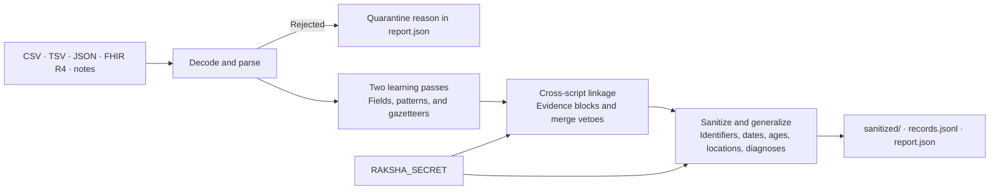

# IncogRx

**Team Knull Void · Yugaantar DevForge · Track 3: Secret Wards**

Shivanshu, Nikitha, Radhika, and Abhishek

IncogRx prepares Indian hospital records for controlled data release. It removes direct identifiers, links records across English, Hindi (Devanagari), and Hinglish, and reduces the identifying power of dates, ages, locations, and rare diagnoses. The scored pipeline runs offline on a CPU with Python's standard library.

[Two-page Project Brief (PDF)](docs/IncogRx_Project_Brief.pdf) · [Test report](docs/TEST_REPORT.md) · [Hosted demo](https://incogrx.vercel.app/)

## Run the pipeline

Python 3.10+ and a POSIX shell are sufficient. The commands below run against the invented sample batch.

```sh
git clone https://github.com/Nikitha1727/IncogRx.git
cd IncogRx
python3 -m pip install -r requirements.txt
export RAKSHA_SECRET="$(python3 -c 'import secrets; print(secrets.token_hex(32))')"
python3 main.py --input demo/samples --output ./sample-release
unset RAKSHA_SECRET
```

Use a fresh output directory outside the input tree for each run. For an authorized rerun that must reproduce pseudonyms, supply the original high-entropy secret through your secret manager. Use a different secret for an independent release. The evaluator entry point is declared in [raksha.toml](raksha.toml).

| Output | Contents |
| --- | --- |
| `sanitized/` | UTF-8 released files with identifiers removed or transformed and sensitive paths cleaned |
| `records.jsonl` | Released record locator and patient pseudonym, or `null` when no patient is assigned |
| `report.json` | File status and reason codes, input fingerprints, counts, timing, memory, and aggregate privacy indicators |

## System architecture



- **Ingestion.** [readers.py](incog/readers.py) handles CSV, TSV, JSON, JSONL, FHIR R4 resources and bundles in JSON, and plain-text notes. It detects delimiters and accepts UTF-8, BOM-marked UTF-16, recognizable BOM-less UTF-16, and legacy Windows-1252. Broken, truncated, or unsupported inputs receive a quarantine reason. The graded CLI keeps PDFs, images, and XML out of the release.
- **Detection.** [fields.py](incog/fields.py) classifies known columns and JSON paths. [sniff.py](incog/sniff.py) infers unfamiliar fields from identifier shapes, contextual values, and terms learned elsewhere in the batch. [detect.py](incog/detect.py) and [textner.py](incog/textner.py) combine patterns, language cues, and batch-learned gazetteers. The same rules reach headers, keys, file paths, FHIR narratives, and decodable text attachments. The detector uses deterministic rules and heuristics. It has no trained ML or CRF component.
- **Linkage and pseudonymization.** [link.py](incog/link.py) blocks candidates by strong identifiers or a normalized name plus corroborating evidence. Devanagari transliteration and phonetic skeletons cover spelling variants. A village match can use a one-year age tolerance, and fragments link only where corroboration points to one eligible cluster. Conflicting birth dates, strong identifiers, or names can veto merges. [crypto.py](incog/crypto.py) derives pseudonyms from the cluster anchor using keyed HMAC-SHA256. The token has no decryption operation. It is reproducible for the same secret and anchor, and it can change if a different record becomes the anchor.

**What makes IncogRx distinct.** A batch can teach the pipeline how a hospital names identifiers and where they appear. Those signals work across scripts and file formats for both detection and linkage. For example, a renamed registration column can still contribute an identifier learned from another export, while safeguards keep patients with shared family contact details apart.

## Privacy and utility

| Released attribute | Default treatment | Utility and trade-off |
| --- | --- | --- |
| Dates | A secret patient-specific offset within 180 days. Birth dates are suppressed. | Keeps intervals and lengths of stay for consistently linked records. Calendar dates lose their original meaning. |
| Age | 20-year bands, with `80+` top-coding | Supports broad cohort analysis and loses fine age resolution. |
| Address | Keep district and the first three PIN digits where applicable. Remove finer location detail. | Supports coarse geography and removes locality-level analysis. |
| Rare coded diagnoses | Replace conditions seen in at most three patients with their ICD-10 chapter where recognized. | Keeps broad disease categories and loses rare-diagnosis specificity. |

Defaults are in [config/policy.yaml](config/policy.yaml). The report measures group sizes on age band, gender, and district among patient clusters with all three attributes. These counts are a screening signal. They provide no guarantee against an attacker with other data.

### Measured results

The [team test report](docs/TEST_REPORT.md) records these results on the organizer practice set of 200 files and 48 patients. The risk figures come from the team's replica of the A2/A3/A4 attacks using a 240-person practice registry.

| Measure | Practice result |
| --- | --- |
| Annotated direct identifiers found in released output | 0 of 3,230 |
| Clinical values retained | 4,682 of 4,855 (96.4%) |
| Linking precision and recall | 1.00 and 1.00 |
| Mean record re-identification risk | 0.369 raw, 0.051 released |
| Patients re-identified at confidence ≥0.5 | 47/48 raw, 14/48 with 10-year bands, 8/48 with 20-year bands |
| Unseen-format variant | Linking precision 1.00, recall 0.87, and no false merges in the reported run |

The 20-year policy lowered the measured re-identification count with clinical-value retention unchanged in that comparison. A 30-year band reduced the count further to 3/48 in the practice replica, at the cost of grouping children and adults. These are dataset-specific results.

## Security and breach assumptions

- **Implemented.** The CLI processes local inputs, prints aggregate counts or an error type, and does not write raw quarantine copies. Quarantine entries carry a reason and an input fingerprint. The report, paths, and releases still warrant access controls. The CLI receives the HMAC secret via the environment and does not include it in outputs. The demo disables request logging and uses temporary job storage.
- **Required deployment controls.** IncogRx does not implement application-layer encryption at rest for raw files or temporary workspaces. Use an encrypted input and workspace volume with access limited to the runner. Keep encryption keys and `RAKSHA_SECRET` in a separate restricted secret store. Apply retention limits and verify cleanup of temporary jobs, snapshots, and backups. A live runner compromise can expose mounted data and process secrets.
- **Breach response.** Contain the runner, revoke workspace and secret access, assess exposed inputs and releases, and issue affected releases with fresh secrets where appropriate. Use only synthetic data in the public demo.

## Known limitations

- Unlabelled names and novel identifier formats can be missed. Common words that resemble learned names can be removed. Review samples of every export type before release.
- Conservative linking can split one person across clusters. The six-character pseudonym space also has finite collision risk. Treat tokens as release-scoped and validate uniqueness before large releases.
- Date shifting preserves duration best when linkage succeeds. Rare values and highly distinctive combinations can still reveal identity.
- Optional OCR can miss or distort text, especially handwritten notes and unmapped glyphs. Review flagged pages and validate any clinical values used downstream.
- The intake checks cover specific unsafe patterns. Production use requires isolated processing and independent security review.

## Demo and tests

```sh
python3 demo/app.py --no-browser
python3 tests/test_multilingual.py
python3 tests/test_regressions.py
python3 tests/test_security_pack.py
```

Open http://127.0.0.1:8765 for the local demo. For optional PDF and image processing, install [the demo dependencies](demo/requirements-demo.txt) and Tesseract. The demo's document mode is separate from the scored CLI. The full hosted demo uses an OCR service, with a hosted fallback that does not process PDFs or images. See [the test report](docs/TEST_REPORT.md) for dataset scope, detailed results, and OCR limits.
